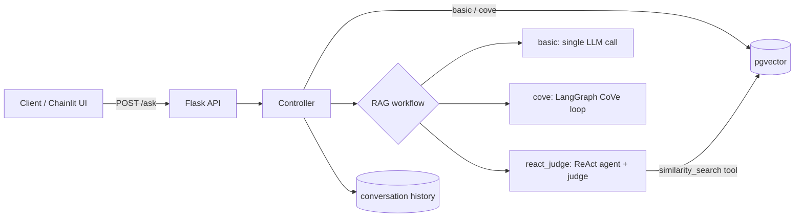
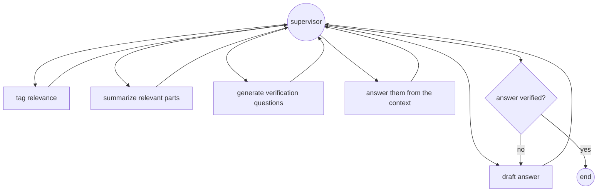

# Agentic RAG chatbot with answer verification

A Flask API that answers questions over your own documents with three interchangeable RAG workflows,
two of them built as **LangGraph** agents that check their answer before replying.

| Workflow | How it answers | Returned with the answer |
|---|---|---|
| `basic` | Retrieve top-k chunks from pgvector, answer with sources | `sources` |
| `cove` | **Chain-of-Verification**: tag relevant passages → summarize → draft → ask verification questions → check → revise if needed | `sources`, `verified` |
| `react_judge` | **ReAct agent** searches the knowledge base itself (search + LLM reranking), then an **LLM judge** scores the answer's grounding | `judge_score`, `judge_remarks` |

## Architecture



**Chain-of-Verification graph** (`src/connectors/graph_cove_rag.py`): a supervisor node routes every step.


After one revision the graph stops, to keep latency and cost bounded.

## Quickstart

Requirements: Python 3.12, Docker, an Azure OpenAI resource with a chat and an embedding deployment.

```bash
cp .env.example .env            # fill in your Azure OpenAI endpoint and key
docker compose up -d pgvector   # vector database

python -m venv .venv && source .venv/bin/activate
pip install -r requirements-dev.txt
python -m src.app               # API on http://localhost:5125
```

Index the sample document, then ask a question:

```bash
curl -X POST localhost:5125/chatbot_api/v1/chatbot/1/generate_embeddings

curl -X POST localhost:5125/chatbot_api/v1/chatbot/1/ask \
  -H "Content-Type: application/json" \
  -d '{"query": "How many days of annual leave do I get?", "workflow": "cove"}'
```

```json
{
  "response": "Full-time employees receive 25 days of paid annual leave per year...",
  "sources": ["company_handbook.md"],
  "verified": true,
  "workflow": "cove",
  "conversation_id": "1"
}
```

Chat UI for manual testing: `chainlit run src/chainlit_app.py --port 5000`
(type `/workflow basic`, `/workflow cove` or `/workflow react_judge` to switch).

Or run everything in Docker: `docker compose up --build`.

### Use your own documents
Put files (`.pdf`, `.txt`, `.md`, `.csv`) in `data/`, list them under `uploaded_files` in
`src/chatbot_data.json`, and call `generate_embeddings` again.

## API

| Method | Endpoint | Body |
|---|---|---|
| `POST` | `/chatbot_api/v1/chatbot/<id>/ask` | `query` (required), `conversation_id`, `workflow` |
| `POST` | `/chatbot_api/v1/chatbot/<id>/generate_embeddings` | none |
| `GET` | `/health_check` | none |

## Project structure

```
src/
├── app.py                      # Flask app factory
├── app_context.py              # shared connectors (LLM, judge LLM, vector store)
├── config/config.py            # settings from environment variables
├── routes/                     # HTTP layer and input validation
├── controllers/                # picks the workflow, ingestion, history
├── connectors/
│   ├── llm_connector.py        # Azure OpenAI chat model
│   ├── vectorstore_connector.py# pgvector + token-based chunking (tiktoken)
│   ├── graph_cove_rag.py       # Chain-of-Verification LangGraph workflow
│   └── graph_react_judge.py    # ReAct agent + LLM reranker + LLM judge
├── models/chatbot.py           # bot settings and conversation history (JSON file)
├── templates/prompt_template.py
└── chainlit_app.py             # chat UI for testing
tests/                          # pytest with fake LLMs: runs without Azure or a database
```

## Tests

```bash
pytest -q
```
The tests replace the LLMs and the vector store with fakes, so they check each workflow's control flow
(verified path, revision path, judge parsing, API validation) without network calls. They run in CI on every push.

## Design choices

- **Token-based chunking** (500 tokens, 100 overlap, measured with `tiktoken`) so chunk sizes match model limits.
- **Separate judge model**: the judge can be a different deployment from the answering model
  (`AZURE_OPENAI_JUDGE_DEPLOYMENT`), which reduces self-agreement bias.
- **The judge sees the retrieved context**, so its score measures grounding, not only fluency.
- **Bounded loops**: CoVe revises at most once and the ReAct agent stops after 5 steps or 60 s.

## Limitations and next steps

- No quantitative evaluation yet. Next: a reference question set and a comparison of the three
  workflows on Hit@k, MRR, faithfulness (RAGAS), latency and cost per answer.
- Retrieval is dense-only; adding BM25 (hybrid search) would help exact terms and codes.
- Conversation history is a JSON file, fine for a demo but not for concurrent users (use a database).
- `cove` and `react_judge` answer each question independently (history is only used by `basic`).

## Context

Cleaned-up and extended version of a proof of concept I built during my internship at
**BACAB IT Services** (summer 2025). Client-specific prompts, data and endpoints were removed;
the sample document in `data/sample/` is fictional.

## License

MIT, see [LICENSE](LICENSE).
